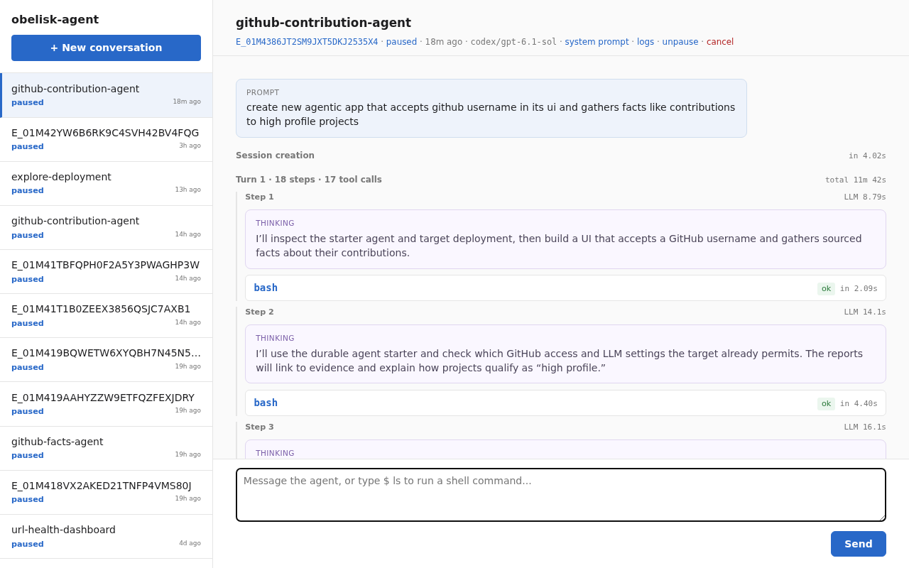

# workflow-agent

> [!NOTE]
> **Preview only.** APIs and design are unstable and subject to change.

A coding agent that runs as a durable [Obelisk](https://obeli.sk) workflow. Each
chat session has a persistent virtual filesystem and a single tool, `bash`, through
which the agent explores, builds and deploys Obelisk apps. You can use the same
shell yourself by prefixing a message with `$ `, e.g. `$ ls /workspace`.

Sessions survive restarts. A session waiting for you or for the model costs
nothing but a database row, and it resumes exactly where it left off.



## Quick start

```sh
nix develop                                # pinned Obelisk and toolchain
export LLM_BASE_URL=http://127.0.0.1:9190  # any OpenAI- or Anthropic-compatible endpoint
just serve
```

Open http://localhost:9090. Then:

- type a prompt to start a session with the agent,
- or start with `$ ` to open a session straight in the shell (`$ help` lists the commands).

You can send messages while the agent is working. A message is queued for the
agent's next step, and a `$ ` command runs right away. A session with no input
for 7 days ends on its own.

## Configuration

Runtime settings use environment variables read at server start. Self API and
Web UI addresses are internal public-env sources declared in `app.toml`:

| Variable | Source | Purpose |
| --- | --- | --- |
| `OBELISK_API_URL` | API listener URL | The agent's own instance for UI polling and session control. |
| `OBELISK_UI_URL` | Web UI listener URL | Browser links; ObeliskNet sets the public URL. |

### LLM

| Variable | Default | Purpose |
| --- | --- | --- |
| `LLM_BASE_URL` | required locally; supplied by cloud | Endpoint URL up to `/v1`, including any gateway prefix, e.g. `https://openrouter.ai/api`. Models are discovered from `GET <LLM_BASE_URL>/v1/models`. |
| `LLM_API_KEY` | unset | Bearer token, if the endpoint needs one. |
| `AGENT_MODELS` | unset | Fallback model catalog (JSON), used when discovery is unavailable. |

For local development, set `LLM_BASE_URL` explicitly. Cloud deployment uses the
account's `llm` integration declared in `app.toml`, overriding local values.
A local endpoint option is
[agent-backed-llm-server](https://github.com/obeli-sk/agent-backed-llm-server),
which serves Claude and Codex subscriptions locally. Two ready-made catalogs ship
for other endpoints, used as `AGENT_MODELS="$(cat models.openrouter.json)"`:

- `models.openrouter.json`: [OpenRouter](https://openrouter.ai), with
  `LLM_BASE_URL=https://openrouter.ai/api` and `LLM_API_KEY`.
  OpenRouter's discovery works too, so the catalog is optional there.
- `models.exe-integration.json`: the keyless exe.dev LLM integration at
  `https://llm.int.exe.xyz`. From outside exe.dev, use the reverse proxy in
  [`examples/exe-llm-proxy.conf`](examples/exe-llm-proxy.conf) over an SSH tunnel.

### Apps in the cloud

The agent controls apps through `obelisk cloud ...`, which talks to a cloud
provisioner with the same API as ObeliskNet. Without a token, `obelisk cloud`
is left out of the system prompt.

```sh
export OBELISK_CLOUD_API_URL=https://...   # the provisioner API
export OBELISK_CLOUD_API_TOKEN=...
```

The agent is then told about your apps and can run, for example:

```sh
obelisk cloud apps list
obelisk cloud app deploy                    # create or update the app from ./app.toml and deploy
obelisk cloud app --app NAME execution list
obelisk cloud app --app NAME secrets set API_KEY --stdin
```

Hosted API and webhook access defaults to `https://*.obelisk.works` on port
443, including `dev.obelisk.works`. For another domain, set
`OBELISK_CLOUD_APPS_DOMAIN`; the grant becomes `https://*.<domain>`. The webhook grant is GET-only and carries no API token.
Find the webhook URL with `obelisk cloud app --app NAME endpoint webhook`.

Interactive and account-level commands (`--fill`, `token new|revoke`) are not
available from the session; `--fill-non-interactive` reads exported shell variables. See [`docs/obelisk-cloud.md`](docs/obelisk-cloud.md).

### Docs and example apps

The agent reads the Obelisk documentation from https://obeli.sk.
`OBELISK_VERSION` pins it to a release (default `latest`) and is stated in the
system prompt; `DOCS_URLS_JSON` replaces the URL list.

JS example apps from the [app catalog](https://obeli.sk/docs/latest/apps/) and the
`website` repo (the docs' Markdown sources) are mounted read-only under
`/workspace/github/<name>`. Override the list with `APPS_JSON`:

```sh
export APPS_JSON='[{"name":"demo-playwright","repo":"demo-playwright","ref":"main"}]'
```

Each entry is `{name, repo}` plus optional `owner` (default `obeli-sk`), `ref`
(default `main`) and a short `description`. Locally the mounts read GitHub
anonymously (60 requests/hour per IP). On ObeliskNet the `github` cloud
integration sets `GITHUB_API_URL` to the integrations proxy, which uses the app
owner's GitHub credentials. GitHub enforces repository permissions.

## The shell

`help` lists the commands, which cover the usual file, text and search tools.
Besides those, the shell provides:

- `obelisk cloud app --app NAME deployment pull ID -o DIRECTORY`: an editable
  snapshot of a deployment; source files load when first read.
- `obelisk cloud ...`: the apps in the cloud (see above).
- `curl`: GET-only, limited to the Obelisk docs and the apps' webhooks.
- `chat`: other sessions (see below).
- `mount`: what is mounted where.

- `ask-user QUESTION`: stops and asks you something mid-task; the question
  appears in the UI as a form.

Background jobs (`&`, `jobs`, `wait`) are not supported.

## Sessions talking to each other: `chat`

```sh
chat models                          # available models
chat list                            # sessions, newest first
chat read E_...                      # transcript (--tail N, --turn N, --json)
chat state E_...                     # whether a session is working or waiting
chat send E_... please re-check X    # message another session
chat create --model claude "prompt"  # start a child session, prints its id
chat create '$ ls -la'               # start a child session in the shell
chat create --name research "..."    # named child session
chat create --top-level "..."        # independent session
chat current                         # this session's id and name
chat rename my-session               # rename this session
```

Child sessions start with an empty history, so put everything they need in
the prompt. They are cancelled together with their parent and are listed under
it in the sidebar.

## Development

```sh
just test-js
just test        # including end-to-end tests
```

The Obelisk API client is generated from a separately pinned contract. Refresh it
with `scripts/update-obelisk-api.sh`; see
[`assets/schemas/README-obelisk-api.md`](assets/schemas/README-obelisk-api.md).

Design notes live in [`docs/`](docs/).

## License

Apache-2.0. The vendored just-bash port keeps its own LICENSE/NOTICE under
`vendor/just-bash`.
